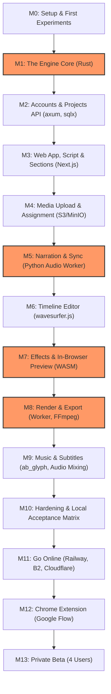

# PACE — Master Implementation Plan (M0 to M13)

> **Source of Truth Reference**:
> - **WHAT to build**: [`docs/product/PACE_PRD.docx`](file:///c:/Users/USER/Desktop/Pace/docs/product/PACE_PRD.docx) (Requirements e.g. `ALN-03`)
> - **HOW to build it**: [`docs/tdd/PACE_Technical_Design_Document.docx`](file:///c:/Users/USER/Desktop/Pace/docs/tdd/PACE_Technical_Design_Document.docx)
> - **WHERE code lives**: [`docs/product/PACE_File_Structure.docx`](file:///c:/Users/USER/Desktop/Pace/docs/product/PACE_File_Structure.docx)
> - **ORDER to build & learn**: [`docs/product/PACE_Milestones.docx`](file:///c:/Users/USER/Desktop/Pace/docs/product/PACE_Milestones.docx)
>
> **Conflict Resolution Hierarchy**:
> PRD wins on *what* · TDD wins on *how* · File Structure wins on *where* · Milestones wins on *order*.

---

## 1. Architectural Foundations & Fixed Decisions

1. **Rust Core**: API (`axum`, `sqlx`), render worker, and a pure shared engine crate (`pace-engine`).
2. **Dual-Compiled Engine**: `pace-engine` has zero I/O (no file, network, clock, or database code). It compiles natively for the server and to WebAssembly (`pace-engine-wasm`, `wasm-bindgen`) for the browser preview, guaranteeing frame parity.
3. **Rust Draws Every Frame**: Rust rasterizes frames on CPU with SIMD via `fast_image_resize`. FFmpeg only encodes video and mixes/ducks audio.
4. **Python Audio Worker**: Dedicated exclusively to audio checks, Opus compression, Groq Whisper transcription (with local `faster-whisper` fallback), and Needleman-Wunsch script alignment.
5. **Web App**: Next.js + TypeScript static export (`output: 'export'`), hosted on Cloudflare Pages in production.
6. **PostgreSQL Dual Role**: PostgreSQL 16 stores all application data **and** serves as the job queue (`jobs` table with `FOR UPDATE SKIP LOCKED`).
7. **Object Storage**: S3-compatible (MinIO locally in Docker, Backblaze B2 online). Heavy media files upload directly from browser to storage via pre-signed URLs, never touching the API.
8. **Shared Data Contracts**: Shapes are defined once in Rust. TypeScript types (`packages/shared-types`) and Python models (`services/audio/src/pace_audio/contracts.py`) are generated via `cargo xtask gen`.
9. **Hardware Constraints**: Intel Core i7-8550U (4 cores/8 threads, 15W TDP), 8 GB RAM. WSL2 capped at 5 GB RAM and 4 GB swap via `.wslconfig`. Rust builds capped at `CARGO_BUILD_JOBS=4` using `mold` linker. Code lives inside Ubuntu at `~/code/pace`.
10. **Local-First & $0 Cost**: Everything runs locally in Docker at $0 until Milestone 11 (Go online).

---

## 2. Milestones Roadmap Overview

> **The Critical Path**: `M1` &rarr; `M5` &rarr; `M7` &rarr; `M8` (The engine &rarr; alignment &rarr; preview &rarr; export). Everything else bends around them.

---

## 3. Detailed Milestone Plans

---

### Milestone 0: Setup and First Experiments
* **Goal**: Laptop ready, Docker runs PostgreSQL 16 and MinIO, and outside services (Groq Whisper, browser-to-storage upload) are proven.
* **PRD Scope**: Foundations; TDD Sections 2–4.
* **Cost**: $0.

#### Learn First
- Docker concepts: Image, Container, Volume, Port mapping (`5432:5432`), Compose (`compose.yml`).
- Git basics: `init`, `add`, `commit`, `branch`, `.gitignore`.
- Linux terminal navigation inside WSL2.

#### Build Steps
1. Configure `.wslconfig` (5 GB RAM, 4 GB swap, 6 processors) and restart WSL.
2. Install build tools in Ubuntu (`clang`, `mold`, `ffmpeg`, `unzip`, `build-essential`).
3. Install Rust toolchain, add `wasm32-unknown-unknown`, install `cargo-binstall`, `wasm-pack`, `cargo-watch`, `cargo-nextest`, and `sqlx-cli`.
4. Install Node.js LTS via `fnm`, enable `corepack` & `pnpm`.
5. Install Python `uv`.
6. Scaffold repository structure at `~/code/pace`.
7. Write `infra/docker/compose.yml` (PostgreSQL 16-alpine + MinIO).
8. Verify Docker containers (`make up`, connect to Postgres via `psql`, MinIO console on port 9001).
9. Write workspace `Cargo.toml`, `rust-toolchain.toml`, `.cargo/config.toml`, root `Makefile`, `.gitignore`, `.env.example`, and `.github/workflows/ci.yml`.
10. **Experiment S2 (Transcription)**: Python script via `uv` sending 1-minute audio to Groq Whisper API (word-level timestamps); benchmark against local `faster-whisper`.
11. **Experiment S3 (Direct Uploads)**: Script generating a pre-signed MinIO PUT link; test uploading straight from browser, simulating network drops.
12. Write `learning/m00-docker-and-setup.md`.

#### Tests to Write First
- Sanity test in `crates/pace-engine` (e.g. `2 + 2 = 4`, `engine_version()`) to verify CI pipeline.

#### Done When
- [x] `docker run hello-world` works; `make up` starts PostgreSQL and MinIO.
- [x] Initial commit created; `cargo test` passes.
- [ ] Groq returns word timings; local `faster-whisper` run duration recorded.
- [ ] Browser upload straight to MinIO via pre-signed link works and survives interruptions.

---

### Milestone 1: The Engine Core (First Real Rust)
* **Goal**: Pure Rust engine splits script into sections, turns scene boundary times into exact frame numbers, models camera motions, and measures CPU frame rasterization speed.
* **PRD Scope**: `SCR-02`, `TML-05..07`, `EFX-01..02` (logic only); TDD Sections 12.1–12.4.
* **Cost**: $0.

#### Learn First
- Rust Book chapters 1–11: Ownership, borrowing, structs, enums, `match`, `Option`, `Result`, modules, traits, and unit testing.
- Why start here: `pace-engine` has no I/O, no network, and no database; compiler errors are pure logic and easy to understand.

#### Build Steps
1. `crates/pace-engine/src/segmentation.rs`: Split script text at blank lines into sections, trimming whitespace.
2. `crates/pace-engine/src/timing.rs`: `Boundary` struct (milliseconds); convert boundaries to exact frame numbers at 30 fps without cumulative rounding drift (`round(time_ms * 30 / 1000)`).
3. Implement timing rules: minimum scene length (0.5s / 15 frames), boundary 0 at 0ms, last boundary at narration end, transition centering and clipping.
4. `crates/pace-engine/src/motion.rs`: `CamState` (`{ cx, cy, zoom }`), presets (`still`, `zoom_in`, `zoom_out`, `pan_*`), easing curves, and intensity scaling.
5. `crates/pace-engine/src/effects.rs`: Automatic variety generator using seeded PRNG (`rand_pcg`); enforce rules (no preset used >2 scenes in a row, no preset >35% of video).
6. `crates/pace-engine/src/fit.rs`: Calculate source crop rectangle from image dimensions, target frame dimensions, focal point, and zoom.
7. **Spike S1 (Render Speed Benchmark)**: Small CLI in `learning/exercises/render-spike`. Loads high-res image, renders 1,800 frames (60s) of slow zoom using `fast_image_resize`, pipes raw RGBA frames to FFmpeg stdin to produce an MP4. Measure FPS at 720p and 1080p.
8. Write `learning/m01-rust-basics.md`.

#### Tests to Write First
- Text segmentation: Windows `\r\n` line endings, lines with spaces only, multiple blank lines, 60,000 character script.
- Property test (`proptest`): 300 random boundaries over 40 minutes sum to total frames; no frame drift.
- Boundary drag test: moving boundary $k$ changes only scenes $k-1$ and $k$.
- Variety test: identical seed yields identical presets; rules respected.
- Fit test: crop rectangle never breaches image bounds for any focal point/zoom.

#### Done When
- All engine tests pass in CI.
- Spike S1 renders a smooth 60-second video; FPS recorded for 720p and 1080p.
- Estimated render time for 22-min 720p video documented in an ADR (`docs/adr/ADR-003-cpu-rasterization.md`).

---

### Milestone 2: Accounts and Projects API
* **Goal**: Users sign in and manage projects through the Rust API; multi-tenant ownership guarantees nobody can see another user's projects.
* **PRD Scope**: `AUTH-01..06`, `PRJ-01..06`, `ADM-01` (basic); TDD Section 7.
* **Cost**: $0.

#### Learn First
- Async Rust with `tokio` (spawning, channels, shared state).
- `axum` routing, extractors (`CurrentUser`, `State`, `Json`), and tower middleware.
- `sqlx`: connection pools, migrations (`sqlx migrate`), compile-time checking (`query!`).
- Error handling: `thiserror` for internal errors, RFC 9457 Problem Details JSON for API responses.

#### Build Steps
1. `crates/pace-db`: Write migration `0001_initial.sql` (users, sessions, login_attempts, projects, audit_log).
2. `crates/pace-api`: Axum server with `/healthz` and `/readyz`.
3. Password hashing with Argon2id; session token generation (cookie: `httpOnly`, `Secure`, `SameSite=Lax`). CSRF token verification on state-changing requests. Lockout after 10 failed login attempts.
4. `scripts/create-admin.sh` and admin endpoints (create, deactivate, reset users).
5. Project endpoints: `POST /projects` (16:9 or 9:16), `GET /projects`, `PATCH /projects/{id}`, `DELETE /projects/{id}`. Optimistic concurrency with `If-Match: <version>`.
6. OpenApi documentation with `utoipa`; add `cargo xtask gen` to output `contracts/openapi.json` and TypeScript types.
7. Write `learning/m02-async-and-axum.md`.

#### Tests to Write First
- Auth tests: valid login, invalid login, lockout after 10 failures.
- Session invalidation: logout, password change, and deactivation terminate active sessions.
- Multi-tenancy isolation (`#[sqlx::test]`): User B gets 404 accessing User A's project.
- Concurrency test: stale `If-Match` receives `409 PROJECT_VERSION_CONFLICT`.

#### Done When
- Full admin and user project lifecycle works via curl/Bruno/Insomnia.
- Automated API test suite passes with fresh PostgreSQL test container.

---

### Milestone 3: Web App: Dashboard, Script, and Sections
* **Goal**: Next.js static export web app running in browser; users sign in, view dashboard, paste script, and split/merge/reorder sections with autosave and undo/redo.
* **PRD Scope**: `SCR-01..07`, `SCR-09`, `PRJ-04`, `PRJ-07`; Screens: Login, Dashboard, Step 1; TDD Section 15.
* **Cost**: $0.

#### Learn First
- Next.js App Router with `output: 'export'` (static HTML/JS hosting on Cloudflare Pages; client-side query parameters `?id=...`).
- TanStack Query (server state caching, optimistic updates).
- Zustand + `zundo` (local editor state with 50+ undo/redo steps).
- Tailwind CSS and `shadcn/ui`.

#### Build Steps
1. Create `apps/web` with Next.js, TypeScript, Tailwind, and `shadcn/ui`.
2. Auth screens: Login, forced password change dialog.
3. Dashboard: Project list cards, New Project modal (name, 16:9 vs 9:16), storage indicator.
4. API integration for sections (`PUT /projects/{id}/script`, `POST /projects/{id}/sections/split|merge|reorder`).
5. Step 1 UI: Script editor with paragraph splitting, section cards with word count and estimated speech duration (150 WPM default), split at cursor, merge with next, drag-and-drop reorder (`dnd-kit`).
6. Autosave engine: 800ms debounce (max 2s) sending project version; conflict dialog on 409 error.
7. Write `learning/m03-web-app.md`.

#### Tests to Write First
- Text integrity property test: concatenating all split sections produces the exact original script.
- Undo/redo unit test: 50 mixed user actions return reliably to previous states.
- Autosave Playwright test: closing tab after editing does not lose data.

#### Done When
- 40-paragraph script splits into 40 sections; reordering and editing persist across reloads.
- Concurrent open tabs refuse silent overwrites.

---

### Milestone 4: Media Upload and Assignment
* **Goal**: Hundreds of images upload directly from browser to storage with resume/retry; images are assigned to sections automatically and manually.
* **PRD Scope**: `MED-01..08`, `ASN-01..05`, `STO-01`, `AUTH-06`; TDD Section 9.
* **Cost**: $0.

#### Learn First
- Pre-signed S3 URLs (PUT/GET authorization without passing files through API).
- S3 Multipart Uploads for large assets.
- Web Workers in browser: computing SHA-256 (`crypto.subtle`) and generating preview/thumbnail WebP images off the main thread.

#### Build Steps
1. `crates/pace-storage`: `Storage` trait, S3 implementation (`rusty-s3` + `reqwest`), storage key generator.
2. Update Compose with `minio-init` to auto-provision the `pace` bucket and CORS policies.
3. API endpoints: `POST /projects/{id}/uploads` (presigned PUT or multipart initiation), completion verification, quota checking.
4. Client upload manager: Web Worker creates preview (1280px WebP), thumbnail (320px WebP), and blurred background; 3 concurrent uploads with automatic retry.
5. Step 2 UI: Upload dropzone, image gallery with natural sorting (`img2` before `img10`), duplicate warnings (content SHA-256 match), aspect ratio mismatch badge.
6. Assignment UI: In-order auto-assignment ($k \to k$), drag-to-section, section swapping, mismatch banner, export blocker on empty sections.
7. Write `learning/m04-uploads.md`.

#### Tests to Write First
- Natural sort sorting tests.
- Quota enforcement: rejecting uploads before signing when storage limit is exceeded.
- Content hash deduplication.
- Playwright upload test: 150 images upload with network cut halfway, successfully resuming.

#### Done When
- 150 images (~300 MB) upload reliably and auto-assign to sections.
- Browser creates thumbnails within 2 seconds of upload completion.

---

### Milestone 5: Narration and Sync (The Python Audio Worker)
* **Goal**: Narration audio is inspected, compressed to Opus, transcribed with Groq (fallback to local `faster-whisper`), and aligned to script sections with confidence flags.
* **PRD Scope**: `NAR-01..06`, `ALN-01..07`, `JOB-01..03`; TDD Sections 8, 10, 11.
* **Cost**: $0.

#### Learn First
- Python dependency management with `uv` (`pyproject.toml`, `uv.lock`).
- PostgreSQL job queue claiming: `SELECT ... FOR UPDATE SKIP LOCKED`, heartbeat timestamps, retry backoff.
- FFmpeg audio filters: `ebur128` (LUFS loudness), `silencedetect` (pause detection), Opus/MP3 transcode.
- Needleman-Wunsch sequence alignment algorithm with fixed anchors.

#### Build Steps
1. `crates/pace-jobs`: Job queue logic (`jobs` table, payload structs, `schemars` &rarr; Pydantic models).
2. `services/audio`: Worker daemon with queue polling, Starlette `/wake` and `/healthz` server.
3. Task `audio.prepare`: Verify audio, run `ebur128`, detect pauses (`silencedetect=-35dB:d=0.15`), generate `peaks.json` waveform, compress to Opus (96 kbps) and 16 kHz mono MP3 for ASR.
4. Task `transcribe`: Groq API (chunked into 10-min slices with 2s overlap, script hint); fallback to local `faster-whisper` on failure.
5. Task `align`:
   - Text normalization: lowercase, punctuation stripping, numbers to words (`num2words`), phonetic keys (`jellyfish`).
   - Anchor detection: unique 3-word matches ordered via longest increasing subsequence.
   - Gap alignment: Needleman-Wunsch between anchors.
   - Scene boundary placement and pause snapping ($\pm 600$ms to nearest $\ge 150$ms pause).
   - Confidence scoring: high, medium, low, and flags (`Unexpected long gap`, `Very short scene`, `Section not found`).
6. Step 3 UI: Audio upload, waveform display (`wavesurfer.js`), real-time job progress (SSE), flag review drawer with "Jump to" links.
7. Write `learning/m05-audio-and-alignment.md`.

#### Tests to Write First
- Alignment unit tests: exact speech, skipped sentences, extra banter, retakes/repeated lines, unspoken sections.
- Monotonic boundaries test: boundary times strictly increase; $b_0 = 0$; $b_N = \text{duration}$.
- Queue concurrency: workers never double-claim jobs; dead worker jobs reassigned after 120s timeout.
- Groq fallback test: stubbed HTTP 429 automatically triggers local engine.

#### Done When
- Alignment accuracy benchmark: $\ge 90\%$ of scene changes land within $\pm 0.75$s; $\ge 80\%$ of errors $> 2$s are flagged.
- 40-minute narration transcribed in $<10$ minutes (Groq) and aligned in $<30$ seconds.
- Stopping worker mid-job and restarting cleanly completes processing.

---

### Milestone 6: Timeline Editor
* **Goal**: Visual timeline showing narration waveform, scene blocks, and draggable scene boundaries with frame snapping and pause snapping.
* **PRD Scope**: `TML-01..07`; TDD Section 15.
* **Cost**: $0.

#### Learn First
- `wavesurfer.js` v7 with Regions plugin fed by pre-computed `peaks.json`.
- Optimistic drag updates and UI coordinate mapping.

#### Build Steps
1. API endpoints: `GET /projects/{id}/timeline`, `PATCH /projects/{id}/boundaries`.
2. Step 4 Timeline UI: Synchronized waveform, scene thumbnails, zoom slider (from full 40-min overview down to 1-second view), scrollable playback.
3. Interactive boundary lines: Drag to shift time, Alt-snap to natural pauses, enforce 0.5s minimum scene length.
4. Manual time entry modal (`mm:ss.mmm`), "Play from here", and scene loop mode.
5. Write `learning/m06-timeline.md`.

#### Tests to Write First
- Dragging boundary $k$ updates scene $k-1$ and $k$ while leaving all other scenes untouched.
- API and client reject out-of-order boundaries or scenes shorter than 0.5s.

#### Done When
- Timeline scrubbing remains smooth at 60 fps for a 40-minute video with 250+ scenes.
- Every flagged scene can be jumped to and corrected directly on the timeline.

---

### Milestone 7: Effects and In-Browser Preview
* **Goal**: Automatic camera motion and transitions applied to all scenes; real-time in-browser video preview driven by `pace-engine` compiled to WebAssembly.
* **PRD Scope**: `EFX-01..06`, `EFX-08..09`, `PRV-01`, `PRV-03..05`; TDD Sections 12, 14.
* **Cost**: $0.

#### Learn First
- Rust WebAssembly compilation via `wasm-bindgen` and `wasm-pack`.
- High-performance data interchange: transferring compact typed arrays between Rust and JS.
- Canvas 2D rendering: `drawImage` with fractional sub-pixel source rects, opacity blending, and `createImageBitmap`.

#### Build Steps
1. Engine: Implement `RenderSpec`, `compile_spec`, spec hashing (SHA-256 of canonical JSON), and `frame_plan(spec, frame) -> FramePlan`. Export TypeScript types via `ts-rs`.
2. `crates/pace-engine-wasm`: Wrapper functions (`load_spec`, `frame_plan`, `scene_at`, `total_frames`). Configure `cargo xtask wasm` outputting to `packages/engine-wasm`.
3. Preview player component: Audio clock synchronization (HTML5 Audio drives animation frame loop), image preloader cache, Canvas 2D drawing of `FramePlan` layers.
4. Scene properties panel: Preset picker, strength selector (subtle, normal, strong), easing selector, fit mode (`Fill` vs `Fit with blur`), interactive focal point clicker, transition selector, and "Re-roll variety" button.
5. Write `learning/m07-webassembly-and-preview.md`.

#### Tests to Write First
- `FramePlan` validation: transition opacity layers sum to 1.0; fade-to-black calculates correct alpha.
- Deterministic spec hash: identical project settings yield identical SHA-256 hash.
- Parity test: native Rust engine and WebAssembly output produce bit-identical `FramePlan` structures for 100 sample frames.

#### Done When
- 22-minute project previews smoothly from any timestamp within 3 seconds of clicking.
- Effect changes reflect instantly in preview canvas and survive page reloads.

---

### Milestone 8: Render and Export
* **Goal**: Standalone Rust render worker claims jobs, renders segments in parallel, encodes via FFmpeg, caches scenes, joins seamlessly, and validates final MP4.
* **PRD Scope**: `EXP-01..11`, `PRV-02`, `STO-02`, `STO-04`, `JOB-04`; TDD Section 13.
* **Cost**: $0.

#### Learn First
- Process piping in Rust: spawning FFmpeg with `tokio::process::Command`, streaming raw RGBA bytes into stdin.
- Parallel computation with `rayon`.
- FFmpeg encoding settings: `-preset veryfast`, closed GOPs (`-x264-params open-gop=0`), concat demuxer (`-c copy`), and `ffprobe` verification.

#### Build Steps
1. `crates/pace-render-worker`: Background queue consumer for `queue = 'render'`.
2. Segment planner: Divide render spec into body segments and transition segments.
3. Raster engine (`raster/cpu.rs`): Execute `FramePlan` using `fast_image_resize` SIMD, background box-blur generator, and layer alpha blending.
4. Segment caching: Hash inputs (image hash, motion, fit, transition, frames) to `{CACHE_DIR}/{prefix}/{hash}.mp4`.
5. FFmpeg piping: Stream raw frames to FFmpeg; concatenate segments via concat demuxer without re-encoding.
6. Validation engine: Probe completed MP4 for black frames (`blackdetect`), missing audio, stream parameters, and duration matching narration within $\pm 1$ frame.
7. Step 6 UI: Export dialog (resolution picker, estimated time/size, daily 1080p counter), real-time progress bar (SSE), cancel button, download button (3-day retention).
8. Parity test suite (Playwright + worker): Compare browser preview frames against rendered MP4 frames (SSIM $\ge 0.95$).
9. Write `learning/m08-rendering.md`.

#### Tests to Write First
- Concat integrity test: joining synthetic segments matches expected total frame count and timescale.
- Scene edit cache test: modifying scene 7 causes re-rendering of only 3 segments (body 7 and its two transitions).
- Validator test: catches simulated black frames, truncated streams, or audio/video length drift.
- Interruption retry test: stopping worker mid-render and clicking "Retry" resumes from cached segments.

#### Done When
- 10-minute 720p export completes locally and passes all export checks.
- All 8 combinations (360p, 480p, 720p, 1080p in 16:9 and 9:16) export and play on VLC, Chrome, iOS, and Android.
- Re-exporting after a 1-scene edit takes $<3$ minutes for a 22-minute project.

---

### Milestone 9: Background Music and Subtitles
* **Goal**: Ducked background music loops seamlessly under narration; subtitles generated from script, editable, styled, and burned into exports.
* **PRD Scope**: `MUS-01..06`, `SUB-01..05`; TDD Sections 11.5, 13.2, 13.5.
* **Cost**: $0.

#### Learn First
- FFmpeg audio filter graphs: `loudnorm` (two-pass EBU R128 to -14 LUFS), `sidechaincompress` (ducking music under speech), `afade`, `amix`, and peak limiting (`-1 dBTP`).
- CPU text rasterization in Rust with `ab_glyph` matching browser font metrics.

#### Build Steps
1. Music upload and settings: volume slider (-40 dB to 0 dB), crossfading loop, fade in/out durations.
2. Step 5 UI: Subtitle editor (edit text, adjust timings, split/merge cues) and style panel (font, size, color, background box opacity, 9:16 safe-area guide).
3. Preview subtitles: Styled CSS overlay synchronized to narration.
4. Render worker audio mixing: FFmpeg pipeline combining narration, music looping, sidechain ducking, and master loudness normalization (-14 LUFS $\pm 1$).
5. Burn-in subtitles: Render worker caches subtitle cue images rendered via `ab_glyph` and composites them onto output video frames.
6. Write `learning/m09-audio-and-subtitles.md`.

#### Tests to Write First
- Subtitle formatting rules: $\le 2$ lines, $\le 42$ chars/line (32 for 9:16), durations between 1–7s.
- Audio mix verification: final loudness $-14 \pm 1$ LUFS, true peak $\le -1$ dBTP, music volume drops during speech.
- Subtitle visual parity: burned-in export frames match browser preview (SSIM).

#### Done When
- Full video with music and burned subtitles exports cleanly and sounds balanced across laptop speakers, phone speakers, and headphones.
- Changing a single subtitle cue only invalidates segments covering that subtitle's timeframe.

---

### Milestone 10: Hardening and Local Acceptance
* **Goal**: Full acceptance test matrix executed locally; security audits, memory leak checks, and Docker production profile verified.
* **PRD Scope**: PRD Sections 10–12 (Local parts), `ADM-02`, `STO-03..05`; TDD Section 19.
* **Cost**: $0.

#### Learn First
- Profiling Rust with `samply` or `flamegraph` to detect memory or CPU hotspots.
- Security vulnerability scanning: `cargo audit`, `cargo deny`, `pip-audit`, `pnpm audit`, `gitleaks`.

#### Build Steps
1. Run `scripts/acceptance-matrix.py` across 5- and 10-minute test projects in all resolutions and aspect ratios, with and without music and subtitles.
2. Security audit: Content Security Policy (CSP), Argon2 password hashing parameters, ownership boundary audit.
3. Implement Janitor background task (purge exports $>3$ days old, abort dangling uploads).
4. Full stack verification with `make full` (`docker compose --profile full up --build`).
5. Run Playwright end-to-end user journey tests against the full Docker stack.
6. Write privacy policy notice and in-app data retention guidelines.
7. Write `learning/m10-hardening.md`.

#### Tests to Write First
- Automated acceptance test report generator storing results in `docs/acceptance/`.

#### Done When
- Every Must requirement passes acceptance tests locally.
- 95%+ success rate across the local test matrix with zero data loss bugs.
- `make full` boots and passes full Playwright test suite without errors.

---

### Milestone 11: Go Online (Railway, Backblaze B2, Cloudflare)
* **Goal**: Production deployment online; long-form 22-, 30-, and 40-minute exports verified on cloud infrastructure; beta budget confirmed.
* **PRD Scope**: TDD Section 18; PRD Release Criteria 3 & 6.
* **Cost**: ~$5–8/month (Railway Hobby plan + domain).

#### Learn First
- Railway configuration: Docker deployments, private networking, serverless sleeping, usage limits.
- Cloudflare Pages: Custom domains, SSL, SPA redirects, security headers.
- Backblaze B2: S3-compatible application keys, CORS configuration.

#### Build Steps
1. Create Backblaze B2 private bucket and scoped application keys.
2. Deploy Next.js web app to Cloudflare Pages at `app.<domain>`.
3. Deploy API, PostgreSQL, and workers to Railway; set up `api.<domain>` sharing root domain for session cookies.
4. Enable serverless sleep for render and audio workers (woken via private network `POST /wake`).
5. Set hard spending limits and alerts in Railway ($8/month cap).
6. Set up hourly Janitor and daily database backups to B2; practice restoring into a temporary database.
7. Run the full acceptance matrix online (including 22-, 30-, and 40-minute tests).
8. Write `learning/m11-going-online.md` and operation runbooks in `docs/runbooks/`.

#### Tests to Write First
- End-to-end smoke test script running against production URL.

#### Done When
- Full 40-minute 720p video exports successfully online.
- Automated daily backups confirmed and restore practiced.
- Monthly operating cost verified at $\le \$8$/month.

---

### Milestone 12: Chrome Extension (Google Flow Import — Should)
* **Goal**: One-click import of generated images and prompts from Google Flow directly into a PACE project.
* **PRD Scope**: `EXT-01..05`, `MED-09`; TDD Section 16.
* **Cost**: $0.

#### Learn First
- Chrome Manifest V3: background service workers, content scripts, popup UI, permissions scoping.

#### Build Steps
1. API endpoints: one-time pairing codes and scoped extension tokens.
2. Build extension popup: pairing code entry, project selector, recent uploads list.
3. Content script (`flow-adapter.ts`): Detect images in Google Flow UI, inject "Send to PACE" button, capture prompt text.
4. Background script: Fetch image blob, request presigned URL from API, upload directly to S3 storage.
5. Write `learning/m12-extension.md`.

#### Tests to Write First
- Adapter unit tests against saved Google Flow DOM snapshots.
- Security test: extension tokens rejected on non-extension API routes.

#### Done When
- 20 images sent sequentially from Google Flow arrive in project media library in order with their prompts.
- UI changes in Google Flow fail gracefully with a notification suggesting manual upload.

---

### Milestone 13: Private Beta
* **Goal**: 3 invited creators complete real-world 20–40 minute videos independently without developer intervention.
* **PRD Scope**: PRD Release Criterion 5.
* **Cost**: Normal operating cost (~$5–8/month).

#### Build Steps
1. Provision accounts for 3 invited creators.
2. Provide a 1-page in-app onboarding guide.
3. Monitor server logs, queue metrics, and error telemetry (Sentry).
4. Resolve friction points and usability bugs immediately.
5. Tag release `v1.0.0`.
6. Write `learning/m13-beta-learnings.md`.

#### Done When
- Each of the 3 creators successfully exports at least one complete 20+ minute video.
- Zero critical bugs or data-loss incidents recorded during beta.

---

## 4. Checkpoints & Decision Gates

| Milestone | Checkpoint Question | If the Answer is NO |
| :--- | :--- | :--- |
| **M1** | Is Rust frame drawing fast and smooth on the laptop? | Default to 720p; if still too slow, switch to FFmpeg filter graph fallback (write ADR). |
| **M5** | Does alignment achieve $\ge 90\%$ accuracy on test set? | Improve text normalization/phonetic matching; evaluate WhisperX; defer M12 to v1.1. |
| **M8** | Are video exports reliable and glitch-free? | Defer camera shake (`EFX-07`), SRT download (`SUB-06`), and bundle export (`STO-05`) to v1.1. |
| **M10** | Do all local release criteria pass at $\ge 95\%$? | Do not go online; resolve bugs locally first. |
| **M11** | Do online exports pass within the $\le \$8$/month budget? | Adjust 1080p daily quota or export retention limits before inviting beta users. |

---

## 5. Definition of Done for Any Task

1. **Test-First**: Unit or integration tests written and failing *before* code is written.
2. **Acceptance Verified**: All PRD acceptance criteria covered by passing tests.
3. **Contracts Up to Date**: `cargo xtask gen` executed; TypeScript and Python models committed with no diffs.
4. **Toolchain Clean**: Zero warnings on `cargo clippy -D warnings`, `cargo fmt`, `ruff`, and `tsc`.
5. **Verified Locally**: Tested in daily development mode and verified in `make full` before milestone sign-off.
6. **Error Codes Stable**: All user-facing errors use documented uppercase error codes (`ApiError`).
7. **Documented**: ADR recorded in `docs/adr/` if decisions changed; learning notes updated in `learning/`.
