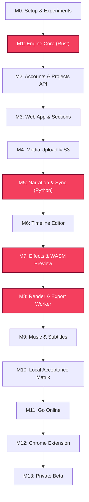

# PACE — Master Implementation Plan (M0 to M13)

| Field | Value |
| :--- | :--- |
| **Product** | **PACE — Automated Narrated Video Production** |
| **Document** | **Master Implementation Plan & Milestones Guide** |
| **Version** | **1.0 (Comprehensive Build Roadmap)** |
| **Owner** | **Peter Oluwafemi Ajao — HeteroGenius** |
| **Status** | Approved for implementation; changes via Architecture Decision Records (ADRs) |
| **Companion Documents** | [PACE_PRD.docx](file:///c:/Users/USER/Desktop/Pace/docs/product/PACE_PRD.docx) (WHAT) · [PACE_Technical_Design_Document.docx](file:///c:/Users/USER/Desktop/Pace/docs/tdd/PACE_Technical_Design_Document.docx) (HOW) · [PACE_File_Structure.docx](file:///c:/Users/USER/Desktop/Pace/docs/product/PACE_File_Structure.docx) (WHERE) · [PACE_Milestones.docx](file:///c:/Users/USER/Desktop/Pace/docs/product/PACE_Milestones.docx) (ORDER) |
| **DOCX Version** | 📄 [PACE_Implementation_Plan.docx](file:///c:/Users/USER/Desktop/Pace/PACE_Implementation_Plan.docx) (Formatted Word Document) |

---

> [!IMPORTANT]
> ### Source of Truth & Conflict Resolution Hierarchy
> Four core design documents define PACE. If specifications ever conflict:
> - **PRD** wins on **WHAT** to build.
> - **TDD** wins on **HOW** it is built.
> - **File Structure** wins on **WHERE** code goes.
> - **Milestones** wins on the **ORDER** we build and learn in.

---

## Table of Contents
1. [Fixed Architectural Decisions & Hardware Boundaries](#1-fixed-architectural-decisions--hardware-boundaries)
2. [Roadmap Architecture & Critical Path](#2-roadmap-architecture--critical-path)
3. [Milestones Summary Matrix](#3-milestones-summary-matrix)
4. [Detailed Milestone Execution Plans](#4-detailed-milestone-execution-plans)
   - [M0: Setup and First Experiments](#milestone-0-setup-and-first-experiments)
   - [M1: The Engine Core (Rust)](#milestone-1-the-engine-core-first-real-rust)
   - [M2: Accounts and Projects API (axum, sqlx)](#milestone-2-accounts-and-projects-api)
   - [M3: Web App: Dashboard, Script, and Sections](#milestone-3-web-app-dashboard-script-and-sections)
   - [M4: Media Upload and Assignment (S3/MinIO)](#milestone-4-media-upload-and-assignment)
   - [M5: Narration and Sync (Python Audio Worker)](#milestone-5-narration-and-sync-python-audio-worker)
   - [M6: Timeline Editor (wavesurfer.js)](#milestone-6-timeline-editor)
   - [M7: Effects and In-Browser Preview (WASM)](#milestone-7-effects-and-in-browser-preview)
   - [M8: Render and Export (Render Worker & FFmpeg)](#milestone-8-render-and-export)
   - [M9: Background Music and Subtitles](#milestone-9-background-music-and-subtitles)
   - [M10: Hardening and Local Acceptance Matrix](#milestone-10-hardening-and-local-acceptance)
   - [M11: Go Online (Railway, Backblaze B2, Cloudflare)](#milestone-11-go-online)
   - [M12: Chrome Extension (Google Flow Import — Should)](#milestone-12-chrome-extension-google-flow-import--should)
   - [M13: Private Beta (3 Real Creators)](#milestone-13-private-beta)
5. [Decision Gates & Checkpoints](#5-decision-gates--checkpoints)
6. [Universal Definition of Done](#6-universal-definition-of-done)

---

## 1. Fixed Architectural Decisions & Hardware Boundaries

| Decision ID | Principle | Why, in Plain Words |
| :--- | :--- | :--- |
| **D1: Rust Dual-Compiled Engine** | `pace-engine` has zero I/O; dual-compiled natively and to WASM | Preview and export run identical logic; preview and export can never disagree. |
| **D2: Rust CPU Frame Drawing** | Rust draws every frame; FFmpeg only encodes video & mixes audio | Silky smooth sub-pixel motion on CPU via SIMD (`fast_image_resize`). |
| **D3: Python Audio Worker** | Single small Python daemon for audio checks, ASR, alignment | Speech ecosystem (Whisper, Needleman-Wunsch) is best in Python; kept strictly isolated. |
| **D4: PostgreSQL Dual Role** | PostgreSQL 16 stores data AND acts as the job queue | One DB to manage; `FOR UPDATE SKIP LOCKED` eliminates extra queue infrastructure. |
| **D5: Direct-to-Storage Uploads** | Browser uploads straight to MinIO/B2 with pre-signed links | Large media files never choke or pass through the API server. |
| **D6: Static Export Web App** | Next.js + TypeScript static export (`output: 'export'`) | Free, instantaneous global hosting on Cloudflare Pages. |
| **D7: Single Source of Truth** | Shared shapes written once in Rust; generated for TS and Python | `cargo xtask gen` guarantees the three languages cannot silently diverge. |
| **D8: Hardware Boundary** | Intel i7-8550U, 8 GB RAM; WSL2 capped at 5 GB RAM, 4 GB swap | Protects host laptop from freezes; Rust builds use `mold` and `jobs=4`. |
| **D9: Local-First & $0 Cost** | Everything runs locally in Docker at $0 until Milestone 11 | No credit cards, cloud accounts, or fees needed to build the complete product. |

---

## 2. Roadmap Architecture & Critical Path

> [!TIP]
> **The Critical Engineering Path**:
> **`M1` (The Engine)** &rarr; **`M5` (Audio Alignment)** &rarr; **`M7` (Browser Preview)** &rarr; **`M8` (Render Worker)**.
> This technical spine proves timing accuracy, speech sync, preview fidelity, and video encoding. Everything else bends around them.

---

## 3. Milestones Summary Matrix

| Milestone | Name | Core Deliverable | Cost | Status |
| :---: | :--- | :--- | :---: | :---: |
| **M0** | **Setup & First Experiments** | Docker runs Postgres & MinIO; Groq & browser uploads proven | **$0** | **Complete** |
| **M1** | **The Engine Core** | Pure Rust engine calculates timing, camera motion, fit | **$0** | **Complete** |
| **M2** | **Accounts & Projects API** | Axum API with auth, multi-tenant isolation, version checks | **$0** | **Complete** |
| **M3** | **Web App: Script & Sections** | Next.js dashboard & script editor with autosave & undo | **$0** | **Complete** |
| **M4** | **Media Upload & Assignment** | Hundreds of images upload to storage with natural sorting | **$0** | **Complete** |
| **M5** | **Narration & Sync** | Python worker transcribes speech & aligns to script with flags | **$0** | **Complete** |
| **M6** | **Timeline Editor** | Draggable boundaries on waveform with pause snapping | **$0** | **Complete** |
| **M7** | **Effects & Browser Preview** | Real-time preview canvas driven by Rust WebAssembly | **$0** | **Complete** |
| **M8** | **Render & Export** | Parallel segment rendering, FFmpeg encoding, cache reuse | **$0** | **Up Next** |
| **M9** | **Music & Subtitles** | Ducked background music; subtitles burned into video | **$0** | Planned |
| **M10** | **Hardening & Local Acceptance** | Full test matrix passed locally in Docker with zero data loss | **$0** | Planned |
| **M11** | **Go Online** | Deployed on Railway, Backblaze B2, and Cloudflare Pages | **$5–8/mo** | Planned |
| **M12** | **Chrome Extension** | One-click image & prompt import from Google Flow UI | **$0** | Planned |
| **M13** | **Private Beta** | 3 invited creators complete 20–40 min videos without help | **$5–8/mo** | Planned |

---

## 4. Detailed Milestone Execution Plans

---

### Milestone 0: Setup and First Experiments

> [!NOTE]
> **In Plain Words**: We set up the laptop so Docker runs the database and storage in small containers, configure the toolchains inside native Ubuntu, and prove external services (Groq Whisper transcription and direct uploads) work before writing application code.

| Attribute | Details |
| :--- | :--- |
| **PRD Scope** | Foundations for all milestones; TDD Sections 2–4 |
| **Cost** | **$0** |
| **Current Status** | **Toolchain installed · Docker Compose running Postgres & MinIO · First Rust test passing** |
| **Fallback Plan** | If Docker Desktop consumes too much RAM on 8 GB, PostgreSQL and MinIO can be run as native services inside Ubuntu. |

#### Learn First
| Topic | Description | Free Resource |
| :--- | :--- | :--- |
| **Docker Fundamentals** | Image vs Container vs Volume vs Port mapping (`5432:5432`); Docker Compose recipes. | Docker Documentation |
| **Git & WSL2** | Git CLI branching, commits, and Linux filesystem permissions. | Pro Git Book (Ch 1–3) |
| **Memory Management** | WSL2 resource boundaries (`.wslconfig`) on an 8 GB laptop. | TDD Section 4.1 |

#### Build Steps
| Step | Task Description | Expected Artifact |
| :---: | :--- | :--- |
| **M0-1** | Configure `.wslconfig` (5 GB RAM, 4 GB swap) and install Docker Desktop with WSL integration. | `C:\Users\<user>\.wslconfig` |
| **M0-2** | Install Ubuntu packages (`clang`, `mold`, `ffmpeg`) and toolchains (Rust, Node `fnm`, Python `uv`). | Verified Linux toolchain |
| **M0-3** | Scaffold workspace layout per `PACE_File_Structure.docx` inside `~/code/pace`. | Repository structure |
| **M0-4** | Create `infra/docker/compose.yml` with PostgreSQL 16 and MinIO. | Active containers on ports 5432 & 9000/9001 |
| **M0-5** | Write root `Cargo.toml`, `.cargo/config.toml` (`mold` linker), and `crates/pace-engine`. | Passing sanity test |
| **M0-6** | **Experiment S2**: Python script using `uv` testing Groq Whisper API vs local `faster-whisper`. | Benchmark timing & word accuracy |
| **M0-7** | **Experiment S3**: Browser upload directly to MinIO via pre-signed URL with simulated disconnect. | Interruption-tolerant upload proof |
| **M0-8** | Record learnings in `learning/m00-docker-and-setup.md`. | Milestone 0 notes |

#### Tests to Write First
- [x] Trivial `cargo test` (`2 + 2 = 4` and `engine_version()`) passes in `pace-engine`.

#### Done When Checklist
- [x] `docker run hello-world` works; `make up` starts PostgreSQL and MinIO.
- [x] Initial Git commit created and `cargo test` passes.
- [ ] Groq returns word timings for audio test clip; `faster-whisper` run duration recorded.
- [ ] Browser upload to MinIO via pre-signed URL works and survives network interruption.

---

### Milestone 1: The Engine Core (First Real Rust)

> [!NOTE]
> **In Plain Words**: The engine is the brain of PACE. It has zero file, network, or database code. Given a script and boundary times, it works out exact frame numbers, camera movements, and crop rectangles. It compiles natively and to WebAssembly.

| Attribute | Details |
| :--- | :--- |
| **PRD Scope** | `SCR-02`, `TML-05..07`, `EFX-01..02` (logic); TDD Sections 12.1–12.4 |
| **Cost** | **$0** |
| **Current Status** | **Up Next** |
| **Fallback Plan** | If 1080p CPU rendering is slow on the laptop, keep 720p as default; online worker has more CPUs. |

#### Learn First
| Topic | Description | Free Resource |
| :--- | :--- | :--- |
| **Ownership & Borrowing** | Rust memory safety rules, stack vs heap, references, lifetimes. | Rust Book Ch 4 |
| **Structs & Enums** | Custom data types, algebraic data types, pattern matching with `match`. | Rust Book Ch 5–6 |
| **Error Handling** | `Result<T, E>`, `Option<T>`, unwrap vs `?`, custom error types. | Rust Book Ch 9 |
| **Property Testing** | Using `proptest` to test hundreds of randomized inputs automatically. | `proptest` docs |

#### Build Steps
| Step | Task Description | Expected Artifact |
| :---: | :--- | :--- |
| **M1-1** | Implement `segmentation.rs`: split script text into sections at blank lines. | `crates/pace-engine/src/segmentation.rs` |
| **M1-2** | Implement `timing.rs`: convert boundary times (ms) to exact frame numbers at 30 fps without drift. | `crates/pace-engine/src/timing.rs` |
| **M1-3** | Implement timing rules: minimum scene length (0.5s), boundary 0 at 0ms, last boundary at narration end. | Timing constraint rules |
| **M1-4** | Implement `motion.rs`: `CamState`, presets (`zoom_in`, `pan_left`, etc.), easing curves. | Camera motion model |
| **M1-5** | Implement `effects.rs`: seeded automatic variety generator (`rand_pcg`) respecting diversity rules. | Deterministic variety engine |
| **M1-6** | Implement `fit.rs`: calculate source crop rectangle from image dimensions, frame size, focal point, and zoom. | Geometry crop calculation |
| **M1-7** | **Spike S1**: CLI in `learning/exercises/render-spike` to measure 60s CPU render speed at 720p/1080p. | Render speed benchmark report |

#### Tests to Write First (TDD)
- Text splitting handles Windows line endings, space-only lines, 60,000 char scripts.
- Property test: 300 random boundaries over 40 mins sum exactly to total frames; no drift.
- Moving boundary $k$ changes only scenes $k-1$ and $k$.
- Variety rules: no preset $>2$ consecutive scenes; no preset $>35\%$ total.
- Fit geometry: crop rectangle never breaches image bounds for any focal point/zoom.

#### Done When Checklist
- [ ] All `pace-engine` unit and property tests pass in CI.
- [ ] Spike S1 renders a smooth 60s MP4; FPS recorded for 720p and 1080p.
- [ ] Estimated render time for 22-min 720p video documented in `docs/adr/ADR-003-cpu-rasterization.md`.

---

### Milestone 2: Accounts and Projects API

> [!NOTE]
> **In Plain Words**: The API is the secure front desk. It checks who you are, creates projects, stores sections, and guarantees that no user can ever see or modify another user's projects.

| Attribute | Details |
| :--- | :--- |
| **PRD Scope** | `AUTH-01..06`, `PRJ-01..06`, `ADM-01` (basic); TDD Section 7 |
| **Cost** | **$0** |
| **Current Status** | Planned |
| **Fallback Plan** | Keep admin features plain; start with `sqlx::query_as` if compile-time macros feel overwhelming initially. |

#### Learn First
| Topic | Description | Free Resource |
| :--- | :--- | :--- |
| **Async Rust & Tokio** | Tasks, async/await, channels, tokio runtime fundamentals. | Tokio Tutorial |
| **Axum Web Framework** | Routing, extractors (`State`, `Json`, `Extension`), tower middleware. | Axum GitHub Examples |
| **SQLx Database Toolkit** | Connection pools, migrations (`sqlx migrate`), compile-time verified queries. | SQLx README |
| **Security & Sessions** | Argon2id password hashing, secure httpOnly session cookies, CSRF tokens. | TDD Section 17 |

#### Build Steps
| Step | Task Description | Expected Artifact |
| :---: | :--- | :--- |
| **M2-1** | Create `pace-db` with migration `0001_initial.sql` (users, sessions, login_attempts, projects, audit_log). | Database schema crate |
| **M2-2** | Create `pace-api` with axum router, middleware (tracing, CORS, request IDs), and `/healthz`. | Base API server |
| **M2-3** | Implement authentication: Argon2id hashing, session tokens in DB, lockout after 10 failures. | Session auth engine |
| **M2-4** | Create `scripts/create-admin.sh` and admin user management routes. | Admin CLI & routes |
| **M2-5** | Implement project CRUD routes with aspect ratio (16:9/9:16) and `If-Match` version checking. | Project API |
| **M2-6** | Define `ApiError` enum producing RFC 9457 Problem Details JSON. | Standardized error types |
| **M2-7** | Add `utoipa` annotations; configure `cargo xtask gen` to export `contracts/openapi.json` and TypeScript types. | Automated contract generator |

#### Tests to Write First (TDD)
- Login succeeds with correct credentials, fails with incorrect, locks after 10 failed attempts.
- Logout, password change, and deactivation terminate active sessions.
- Multi-tenancy isolation: all project endpoints return 404 when accessed by another user.
- Stale `If-Match` version returns `409 PROJECT_VERSION_CONFLICT`.

#### Done When Checklist
- [x] Full user and project lifecycle functional via curl/Bruno against local PostgreSQL.
- [x] All API integration tests pass in CI.

---

### Milestone 3: Web App: Dashboard, Script, and Sections

> [!NOTE]
> **In Plain Words**: The creator opens their browser, logs in, creates a video project, pastes their script, and edits paragraphs into sections with instant autosave and undo/redo.

| Attribute | Details |
| :--- | :--- |
| **PRD Scope** | `SCR-01..07`, `SCR-09`, `PRJ-04`, `PRJ-07`; Screens: Sign in, Dashboard, Step 1; TDD Section 15 |
| **Cost** | **$0** |
| **Current Status** | Planned |
| **Fallback Plan** | Script import from `.txt`/`.docx` (`SCR-08`) can wait until M10; keep styling minimal. |

#### Learn First
| Topic | Description | Free Resource |
| :--- | :--- | :--- |
| **Next.js Static Export** | App Router with `output: 'export'`, query params (`?id=...`), client-side fetching. | Next.js Documentation |
| **TanStack Query** | Server cache management, mutations, optimistic updates, query invalidation. | TanStack Query Docs |
| **Zustand & Zundo** | Client-side editor state management with automatic undo/redo history. | Zustand Docs |
| **Tailwind & shadcn/ui** | Utility-first CSS and accessible headless component primitives. | shadcn/ui Docs |

#### Build Steps
| Step | Task Description | Expected Artifact |
| :---: | :--- | :--- |
| **M3-1** | Scaffold `apps/web` with Next.js, TypeScript, Tailwind CSS, and `shadcn/ui`. | Web app foundation |
| **M3-2** | Build sign-in screen, forced password change dialog, and persistent session provider. | Authentication UI |
| **M3-3** | Build Dashboard: project list, New Project modal (name, 16:9 vs 9:16), storage indicator. | Dashboard UI |
| **M3-4** | Add API sections routes (`scripts`, `sections` tables; split, merge, reorder). | Sections API |
| **M3-5** | Build Step 1 UI: script editor with blank-line splitting, word count, 150 WPM duration estimates. | Script editor |
| **M3-6** | Implement interactive section editing: split at cursor, merge with next, drag reorder (`dnd-kit`). | Section management |
| **M3-7** | Build editor store with Zustand, zundo (50+ undo steps), and autosave indicator (`Saving`/`Saved`/`Error`). | Autosave & history engine |

#### Tests to Write First (TDD)
- Text integrity: concatenating all section texts exactly equals original script.
- Undo/redo: 50 mixed user actions return reliably to earlier states.
- Autosave: closing tab 2s after edit preserves changes (Playwright).

#### Done When Checklist
- [x] 40-paragraph script splits into 40 sections; reordering survives reload.
- [x] Two open tabs editing the same project cannot overwrite each other silently.

---

### Milestone 4: Media Upload and Assignment

> [!NOTE]
> **In Plain Words**: The creator uploads hundreds of images. Files fly directly from the browser into storage using pre-signed links. A Web Worker creates thumbnails and checks for duplicates, and PACE assigns images to sections in order.

| Attribute | Details |
| :--- | :--- |
| **PRD Scope** | `MED-01..08`, `ASN-01..05`, `STO-01`, `AUTH-06`; TDD Section 9 |
| **Cost** | **$0** |
| **Current Status** | Planned |
| **Fallback Plan** | Keep simple retries for images; use multipart uploads strictly for narration audio. |

#### Learn First
| Topic | Description | Free Resource |
| :--- | :--- | :--- |
| **Pre-Signed S3 URLs** | Delegating secure PUT/GET upload permissions without proxying data through API. | AWS S3 / MinIO Docs |
| **Multipart Uploads** | Chunking large files into 8 MB parts with resume capabilities. | S3 Multipart Docs |
| **Web Workers & SubtleCrypto** | Off-main-thread image hashing (SHA-256) and canvas resizing. | MDN Web Workers |

#### Build Steps
| Step | Task Description | Expected Artifact |
| :---: | :--- | :--- |
| **M4-1** | Create `pace-storage`: `Storage` trait, S3 implementation (`rusty-s3` + `reqwest`), key formats. | Storage abstraction |
| **M4-2** | Add `minio-init` container to Docker Compose to auto-create `pace` bucket and CORS rules. | Automated bucket init |
| **M4-3** | API upload routes: `POST /projects/{id}/uploads` (presigned PUT or multipart), verify sizes. | Upload signing API |
| **M4-4** | Client upload manager: Web Worker generates thumbnail (320px WebP), preview (1280px), and SHA-256. | Fast client prep |
| **M4-5** | Build Step 2 UI: dropzone, gallery with natural sorting (`img2` before `img10`), duplicate warnings. | Media library UI |
| **M4-6** | Build Assignment UI: auto-assign ($k \to k$), drag-assign, section swap, mismatch banner, export block. | Assignment workflow |

#### Tests to Write First (TDD)
- Natural sorting handles mixed case, leading zeros, and numerical sequences.
- Uploads over user storage quota are refused before signing; usage updates on delete.
- Deduplication detects identical file contents.
- Playwright test: 150 images upload with simulated network disconnect, resuming cleanly.

#### Done When Checklist
- [ ] 150 images (~300 MB) upload reliably and auto-assign to sections.
- [ ] Thumbnails appear within 2 seconds of each upload finishing.

---

### Milestone 5: Narration and Sync (Python Audio Worker)

> [!NOTE]
> **In Plain Words**: The creator uploads voice narration. A Python worker compresses it, finds natural speech pauses, transcribes it via Groq Whisper, and matches spoken words to the script to set scene change times.

| Attribute | Details |
| :--- | :--- |
| **PRD Scope** | `NAR-01..06`, `ALN-01..07`, `JOB-01..03`; TDD Sections 8, 10, 11 |
| **Cost** | **$0** |
| **Current Status** | Planned |
| **Fallback Plan** | Do not lower accuracy target (it is the heart of PACE). Defer Chrome extension (M12) to make time if needed. |

#### Learn First
| Topic | Description | Free Resource |
| :--- | :--- | :--- |
| **Python uv Tooling** | Managing Python 3.12 dependencies with `uv lock` and `pyproject.toml`. | Astral uv Docs |
| **Postgres Job Queues** | `FOR UPDATE SKIP LOCKED`, heartbeats, retry backoff, and poison pills. | TDD Section 8 |
| **FFmpeg Audio Filters** | `ebur128` loudness measurement, `silencedetect` for pause finding, Opus encoding. | FFmpeg Documentation |
| **Sequence Alignment** | Needleman-Wunsch algorithm, 3-word fixed anchors, and phonetic matching. | TDD Section 11 |

#### Build Steps
| Step | Task Description | Expected Artifact |
| :---: | :--- | :--- |
| **M5-1** | Create `pace-jobs`: queue polling logic, `jobs` table migrations, payload JSON schemas. | Job queue core |
| **M5-2** | Create `services/audio`: daemon process, queue worker loop, Starlette `/wake` server. | Audio worker daemon |
| **M5-3** | Implement `audio.prepare`: ffprobe checks, `ebur128`, `silencedetect`, `peaks.json` waveform, Opus transcode. | Audio inspection & prep |
| **M5-4** | Implement `transcribe`: Groq API with 10-min chunks and 2s overlap; fallback to local `faster-whisper`. | Speech-to-text pipeline |
| **M5-5** | Implement `align`: text normalization (`num2words`), fixed anchors, Needleman-Wunsch, pause snapping, flags. | Script alignment engine |
| **M5-6** | Generate synthetic test narrations with Piper TTS; record real-world benchmark narrations. | Test fixtures |
| **M5-7** | Build Step 3 UI: narration upload, waveform, SSE progress stream, flag list with Jump-to links. | Sync UI |

#### Tests to Write First (TDD)
- Alignment unit tests: exact speech, skipped words, retakes/repeated lines, unspoken sections.
- Monotonic boundaries: boundary times strictly increase; first is 0ms; last is narration end.
- Queue resilience: two workers never claim the same job; failed worker job recovered after 120s.
- Groq fallback: stubbed HTTP 429 automatically fails over to local `faster-whisper`.

#### Done When Checklist
- [ ] Alignment accuracy benchmark: $\ge 90\%$ scene changes within $\pm 0.75$s; $\ge 80\%$ errors $> 2$s flagged.
- [ ] 40-min narration transcribed in $<10$ mins (Groq) and aligned in $<30$ seconds.
- [ ] Killing audio worker mid-job and restarting finishes the job automatically.

---

### Milestone 6: Timeline Editor

> [!NOTE]
> **In Plain Words**: The creator fine-tunes timing on a visual waveform. Dragging a boundary line shifts time between two scenes without affecting any other scene in the video.

| Attribute | Details |
| :--- | :--- |
| **PRD Scope** | `TML-01..07`; TDD Section 15 |
| **Cost** | **$0** |
| **Current Status** | Planned |
| **Fallback Plan** | Phones receive read-only summary; full editing requires desktop/laptop width ($\ge 1024$px). |

#### Learn First
| Topic | Description | Free Resource |
| :--- | :--- | :--- |
| **WaveSurfer.js v7** | Waveform rendering with Regions plugin fed by pre-computed `peaks.json`. | WaveSurfer Docs |
| **Optimistic UI Updates** | Rendering drag updates instantly while syncing asynchronously with API. | TanStack Query Guides |

#### Build Steps
| Step | Task Description | Expected Artifact |
| :---: | :--- | :--- |
| **M6-1** | Add API boundaries routes (`GET /projects/{id}/timeline`, `PATCH /projects/{id}/boundaries`). | Timeline API |
| **M6-2** | Build Step 4 Timeline: waveform canvas, scene thumbnail blocks, zoom slider, scroll sync. | Interactive timeline |
| **M6-3** | Implement draggable boundary lines with frame snapping, Alt-snap to pauses, and 0.5s minimum scene length. | Boundary interaction |
| **M6-4** | Add exact time modal (`mm:ss.mmm`), Play from here, and scene loop mode. | Playback controls |

#### Tests to Write First (TDD)
- Dragging boundary $k$ updates scene $k-1$ and $k$ while leaving all other scenes identical.
- Order and 0.5s minimum scene duration enforced in client and API.

#### Done When Checklist
- [ ] 40-minute project with 250 scenes scrubs smoothly at 60 fps.
- [ ] Every flagged boundary can be reached directly from flag drawer and corrected.

---

### Milestone 7: Effects and In-Browser Preview

> [!NOTE]
> **In Plain Words**: PACE automatically applies varied camera motions. In the browser, you hit Play: the narration plays, and Rust (compiled to WebAssembly) calculates frame draw plans rendered onto a canvas at 30 fps in real-time.

| Attribute | Details |
| :--- | :--- |
| **PRD Scope** | `EFX-01..06`, `EFX-08..09`, `PRV-01`, `PRV-03..05`; TDD Sections 12, 14 |
| **Cost** | **$0** |
| **Current Status** | **Complete** |
| **Fallback Plan** | Camera shake (`EFX-07`) can defer to v1.1. If WASM setup issues arise, get `total_frames` working first. |

#### Learn First
| Topic | Description | Free Resource |
| :--- | :--- | :--- |
| **Rust to WebAssembly** | `wasm-bindgen`, `wasm-pack`, JavaScript interoperability, memory management. | wasm-bindgen Guide |
| **Typed Arrays & Performance** | Passing flat numeric arrays between WASM and JS to avoid JSON serialization. | MDN TypedArrays |
| **HTML5 Canvas 2D** | `drawImage` with sub-pixel source cropping, `globalAlpha` blending, `createImageBitmap`. | HTML5 Canvas Specs |

#### Build Steps
| Step | Task Description | Expected Artifact |
| :---: | :--- | :--- |
| **M7-1** | Implement `RenderSpec`, `compile_spec`, spec hashing, and `frame_plan` in `pace-engine`; export via `ts-rs`. | Engine spec & plan |
| **M7-2** | Create `pace-engine-wasm` wrapper; configure `cargo xtask wasm` outputting `packages/engine-wasm`. | WASM engine package |
| **M7-3** | API render-spec endpoint: compiles frozen spec and attaches signed preview image links. | Render spec API |
| **M7-4** | Build PreviewPlayer component: HTML5 Audio clock, image prefetch cache, Canvas 2D renderer. | Real-time player |
| **M7-5** | Build Scene properties panel: preset picker, strength, easing, fit mode, focal point clicker, Re-roll. | Visual effects UI |

#### Tests to Write First (TDD)
- `FramePlan` validation: transition layer opacities sum to 1.0; fade-to-black calculates correct alpha.
- Spec hash is deterministic: identical project settings produce identical SHA-256.
- WASM parity test: WebAssembly and native builds output bit-identical `FramePlan`s for 100 sample frames.

#### Done When Checklist
- [x] 22-minute project previews smoothly from any timestamp within 3s.
- [x] Changing an effect updates the preview canvas instantly and persists across reload.

---

### Milestone 8: Render and Export

> [!NOTE]
> **In Plain Words**: The render worker takes the frozen spec, asks the engine what every frame looks like, draws frames on CPU, feeds them to FFmpeg, and caches scene segments. Small edits re-render only the affected scenes.

| Attribute | Details |
| :--- | :--- |
| **PRD Scope** | `EXP-01..11`, `PRV-02`, `STO-02`, `STO-04`, `JOB-04`; TDD Section 13 |
| **Cost** | **$0** |
| **Current Status** | Planned |
| **Fallback Plan** | Test with 5–10 min clips locally on laptop; full 40-min runs verified online in M11. |

#### Learn First
| Topic | Description | Free Resource |
| :--- | :--- | :--- |
| **Piping to FFmpeg** | Spawning child processes with `tokio::process::Command` and streaming raw RGBA bytes into stdin. | Tokio Process Docs |
| **Parallel SIMD Resizing** | `rayon` threadpool + `fast_image_resize` for high-speed CPU image scaling. | `fast_image_resize` Docs |
| **Segment Concatenation** | FFmpeg concat demuxer with stream copy (`-c copy`) for instantaneous joining. | FFmpeg Concat Demuxer |

#### Build Steps
| Step | Task Description | Expected Artifact |
| :---: | :--- | :--- |
| **M8-1** | Create `pace-render-worker` daemon claiming jobs from `queue = 'render'`. | Render worker daemon |
| **M8-2** | Implement segment planner: divide render spec into body and transition segments. | Segment planning |
| **M8-3** | Implement rasterizer (`raster/cpu.rs`): execute `FramePlan` using `fast_image_resize` and box-blur. | CPU frame drawing |
| **M8-4** | Implement segment cache: key by hash of image, motion, fit, and frames to avoid duplicate work. | Scene caching |
| **M8-5** | Implement FFmpeg encoder, concat demuxer, and audio muxing pipeline. | Video encoding engine |
| **M8-6** | Implement export validator: probe black frames, silence, stream specs, and narration duration parity. | Export validation |
| **M8-7** | Build Step 6 UI: Export modal (resolutions, estimated time/size, 1080p limit), SSE progress, downloads. | Export UI |
| **M8-8** | Add automated parity test: compare preview canvas frames against rendered MP4 frames (SSIM $\ge 0.95$). | Frame parity test |

#### Tests to Write First (TDD)
- Concat integrity: joining synthetic segments matches expected frame count and timescale.
- Cache invalidation: editing scene 7 re-renders exactly 3 segments (body 7 and two transitions).
- Validator catches: truncated files, missing audio, black gaps, duration mismatch.
- Interruption test: stopping worker mid-export and clicking Retry resumes from cached segments.

#### Done When Checklist
- [ ] 10-min 720p export completes locally and passes all validation checks.
- [ ] All 8 size and orientation combinations export and play on VLC, Chrome, iOS, and Android.
- [ ] Re-exporting after a single-scene edit takes $<3$ minutes for a 22-minute video.

---

### Milestone 9: Background Music and Subtitles

> [!NOTE]
> **In Plain Words**: Music plays softly under narration and automatically dips when the narrator speaks. Subtitles are generated from the script, can be edited and styled, and are burned directly into the video.

| Attribute | Details |
| :--- | :--- |
| **PRD Scope** | `MUS-01..06`, `SUB-01..05`; TDD Sections 11.5, 13.2, 13.5 |
| **Cost** | **$0** |
| **Current Status** | Planned |
| **Fallback Plan** | Keep to the short curated font list; custom fonts defer to v1.1. |

#### Learn First
| Topic | Description | Free Resource |
| :--- | :--- | :--- |
| **FFmpeg Audio Filter Graphs** | `loudnorm`, `afade`, `sidechaincompress` (ducking), `amix`, and peak limiting. | FFmpeg Audio Filters |
| **Text Rasterization in Rust** | Rendering glyphs, outlines, and backgrounds with `ab_glyph` matching browser fonts. | `ab_glyph` Docs |

#### Build Steps
| Step | Task Description | Expected Artifact |
| :---: | :--- | :--- |
| **M9-1** | Implement music upload, volume slider (-40 dB to 0 dB), crossfading loop, and fade in/out settings. | Music management |
| **M9-2** | Build Step 5 UI: Subtitle editor (edit text, adjust timings, split/merge) and style panel with safe-area guides. | Subtitle editor UI |
| **M9-3** | Render worker audio mix pipeline: `loudnorm` (-16 LUFS narration), sidechain ducking, master -14 LUFS mix. | Audio mix pipeline |
| **M9-4** | Render worker subtitle burn-in: pre-render subtitle images via `ab_glyph` and composite onto video frames. | Subtitle rasterization |

#### Tests to Write First (TDD)
- Subtitle rules: $\le 2$ lines, $\le 42$ chars/line (32 for 9:16), durations 1–7s.
- Mix verification: final mix $-14 \pm 1$ LUFS, peak $\le -1$ dBTP, music dips under speech.
- Visual parity: burned-in export subtitle frames match browser preview (SSIM $\ge 0.95$).

#### Done When Checklist
- [ ] Video with music and burned subtitles exports cleanly and sounds balanced across speakers and headphones.
- [ ] Editing one subtitle cue only invalidates segments covering that subtitle's timeframe.

---

### Milestone 10: Hardening and Local Acceptance

> [!NOTE]
> **In Plain Words**: We run the entire product in Docker exactly as it will run online, run the full test matrix on short and medium videos, and perform security and memory leak checks.

| Attribute | Details |
| :--- | :--- |
| **PRD Scope** | PRD Sections 10–12 (local part), `ADM-02`, `STO-03..05`; TDD Section 19 |
| **Cost** | **$0** |
| **Current Status** | Planned |
| **Fallback Plan** | Add zero new features here; anything new goes to v1.1 backlog. |

#### Learn First
| Topic | Description | Free Resource |
| :--- | :--- | :--- |
| **Rust Profiling** | Using `samply` or `flamegraph` to identify CPU hotspots and memory allocations. | Rust Profiling Tools |
| **Security Scanners** | `cargo audit`, `cargo deny`, `pip-audit`, `pnpm audit`, `gitleaks` in CI. | DevSecOps Guides |

#### Build Steps
| Step | Task Description | Expected Artifact |
| :---: | :--- | :--- |
| **M10-1** | Execute `scripts/acceptance-matrix.py` locally for 5- and 10-minute projects across all resolutions. | Local test matrix |
| **M10-2** | Security pass: Content Security Policy, Argon2 tuning, ownership boundary test suite. | Security audit |
| **M10-3** | Complete Janitor background task (3-day export cleanup, orphan upload aborts). | Janitor service |
| **M10-4** | Verify full stack with `make full` (`docker compose --profile full up --build`). | Full container stack |
| **M10-5** | Run Playwright end-to-end user journeys against full Docker stack. | End-to-end journeys |
| **M10-6** | Write privacy policy notice and in-app data retention explanations. | Compliance documentation |

#### Tests to Write First (TDD)
- Automated acceptance test report generated and stored in `docs/acceptance/`.

#### Done When Checklist
- [ ] Every Must requirement passes its acceptance tests locally.
- [ ] Local acceptance matrix passes at $\ge 95\%$ with zero data loss bugs.
- [ ] `make full` boots and runs complete product in Docker without errors.

---

### Milestone 11: Go Online

> [!NOTE]
> **In Plain Words**: PACE goes online for the first time. The web app deploys to Cloudflare Pages, the API and workers deploy to Railway with automatic sleep, and storage switches from MinIO to Backblaze B2.

| Attribute | Details |
| :--- | :--- |
| **PRD Scope** | TDD Section 18; PRD Release Criteria 3 (online) & 6 |
| **Cost** | **~$5–8/month** |
| **Current Status** | Planned |
| **Fallback Plan** | If cloud renders cost more than expected, lower daily 1080p allowance or default to 720p. |

#### Learn First
| Topic | Description | Free Resource |
| :--- | :--- | :--- |
| **Railway PaaS** | Docker deployment, serverless sleeping, private networking, volume mounts. | Railway Documentation |
| **Cloudflare Pages** | Deploying static SPAs, custom domains, security headers. | Cloudflare Pages Docs |
| **Backblaze B2** | S3-compatible bucket permissions, application keys, CORS rules. | Backblaze B2 Docs |

#### Build Steps
| Step | Task Description | Expected Artifact |
| :---: | :--- | :--- |
| **M11-1** | Deploy render worker to Railway free trial; benchmark render speed against laptop. | Cloud render benchmark |
| **M11-2** | Configure domain on Cloudflare; deploy web app to Cloudflare Pages (`app.<domain>`). | Web app hosting |
| **M11-3** | Provision Backblaze B2 private bucket, scoped keys, and CORS rules; switch from MinIO to B2. | Cloud storage setup |
| **M11-4** | Deploy API, PostgreSQL, and workers to Railway; enable serverless sleep and $8 spending limit. | Production backend |
| **M11-5** | Configure daily database backup to B2 and practice a restore into a temporary database. | Backup & recovery |
| **M11-6** | Run full acceptance matrix online, including 22-, 30-, and 40-minute videos. | Online validation matrix |

#### Tests to Write First (TDD)
- Automated online smoke test script: sign-in, upload, sync, and export 1-min video against production.

#### Done When Checklist
- [ ] Full acceptance matrix passes at $\ge 95\%$ online.
- [ ] Automated daily backups verified and restore practiced.
- [ ] Monthly operating cost verified at $\le \$8$/month.

---

### Milestone 12: Chrome Extension (Google Flow Import — Should)

> [!NOTE]
> **In Plain Words**: While generating images in Google Flow, the creator clicks a 'Send to PACE' button to upload images and their generation prompts directly into their project without manual file saving.

| Attribute | Details |
| :--- | :--- |
| **PRD Scope** | `EXT-01..05`, `MED-09`; TDD Section 16 |
| **Cost** | **$0** |
| **Current Status** | Planned |
| **Fallback Plan** | Optional for v1. If time is short, ship v1 with manual upload and make this the first v1.1 item. |

#### Learn First
| Topic | Description | Free Resource |
| :--- | :--- | :--- |
| **Chrome Extensions V3** | Service workers, content scripts, DOM injection, permissions scoping. | Chrome Extensions Docs |

#### Build Steps
| Step | Task Description | Expected Artifact |
| :---: | :--- | :--- |
| **M12-1** | Add API one-time pairing codes and scoped extension tokens. | Extension auth API |
| **M12-2** | Build extension popup: enter pairing code, select project, view recent transfers. | Popup UI |
| **M12-3** | Build content script (`flow-adapter.ts`): detect Google Flow images, inject 'Send to PACE' button. | DOM injection |
| **M12-4** | Background script: fetch image blob, request presigned URL from API, upload to storage. | Background upload |

#### Tests to Write First (TDD)
- Adapter unit tests against saved Google Flow DOM snapshots.
- Security: extension tokens rejected on all non-extension API routes.

#### Done When Checklist
- [ ] 20 images sent from live Google Flow session arrive in order with prompts.
- [ ] DOM changes in Google Flow fail gracefully with a notice suggesting manual upload.

---

### Milestone 13: Private Beta

> [!NOTE]
> **In Plain Words**: Three invited video creators use PACE to produce their own real videos. We watch for confusion or errors, fix issues immediately, and prove the product works before wider release.

| Attribute | Details |
| :--- | :--- |
| **PRD Scope** | PRD Release Criterion 5 |
| **Cost** | Normal operating cost (~$5–8/month) |
| **Current Status** | Planned |
| **Fallback Plan** | If a user is blocked by confusion rather than a bug, fix the UI wording before declaring v1 done. |

#### Learn First
| Topic | Description | Free Resource |
| :--- | :--- | :--- |
| **User Feedback Synthesis** | Categorizing creator feedback into blockers, usability polish, and v1.1 features. | Product Management |

#### Build Steps
| Step | Task Description | Expected Artifact |
| :---: | :--- | :--- |
| **M13-1** | Create accounts for 3 invited creators and provide a 1-page onboarding guide. | Beta onboarding |
| **M13-2** | Monitor error telemetry (Sentry) and server logs during user runs. | Active monitoring |
| **M13-3** | Fix any blocker or confusion immediately; list enhancements for v1.1. | Rapid bug triage |
| **M13-4** | Tag release `v1.0.0` and archive final acceptance report. | Official v1.0.0 release |

#### Tests to Write First (TDD)
- Run online smoke tests after every hotfix deployment.

#### Done When Checklist
- [ ] Each of the 3 creators exports at least one complete 20+ minute video without developer help.
- [ ] Zero data loss and zero critical bugs during the beta period.

---

## 5. Decision Gates & Checkpoints

| Milestone | Checkpoint Question | If the Answer is NO |
| :---: | :--- | :--- |
| **M1** | Is Rust frame drawing fast and smooth on the laptop? | Default to 720p; if still too slow, switch to FFmpeg filter graph fallback (write ADR). |
| **M5** | Does alignment achieve $\ge 90\%$ accuracy on test set? | Improve text normalization/phonetic matching; evaluate WhisperX; defer M12 to v1.1. |
| **M8** | Are video exports reliable and glitch-free? | Defer camera shake (`EFX-07`), SRT download (`SUB-06`), and bundle export (`STO-05`) to v1.1. |
| **M10** | Do all local release criteria pass at $\ge 95\%$? | Do not go online; resolve bugs locally first. |
| **M11** | Do online exports pass within the $\le \$8$/month budget? | Adjust 1080p daily quota or export retention limits before inviting beta users. |

---

## 6. Universal Definition of Done

Every task, PR, and milestone must satisfy all 7 criteria before being considered finished:

1. **Test-First Verification**: Its PRD acceptance criteria are covered by failing unit/integration tests written before the implementation code.
2. **Automated Contracts**: `cargo xtask gen` has been run; generated TypeScript types and Python models are committed with no diffs.
3. **Clean Toolchain**: Zero warnings under `cargo clippy -D warnings`, `cargo fmt`, `ruff`, `mypy`, and TypeScript strict mode.
4. **Environment Parity**: Verified in daily local development mode AND verified in `make full` (full Docker stack) before milestone sign-off.
5. **Error Standardization**: Every error has a documented `UPPER_SNAKE` error code (`ApiError`) and a plain-English user explanation.
6. **Architecture Integrity**: Any change to architecture or requirements is documented in `docs/adr/` and reflected in PRD/TDD.
7. **Learning Notes**: Three lines of personal learning notes and takeaways recorded in `learning/mNN-*.md`.
